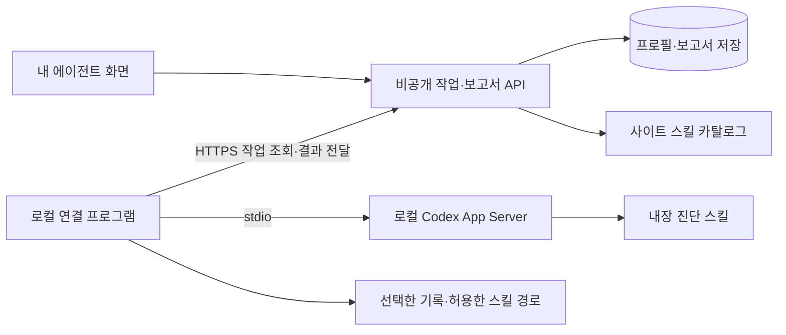

# 내 에이전트: 활용 진단과 스킬 성장 보고서 설계

작성일: 2026-10-27 · 상태: 단계별 설계. 개인 연결·초기 보고서·로컬 작성·선택 사례·자기 평가 구현 완료. 자동 설치·복구는 미구현. 현재 실행 방법과 차이는 [구현 안내](./AGENT_COACH_IMPLEMENTATION.md)를 참고한다.

## 1. 제품 정의

**내 에이전트는 사용자가 에이전트에게 일을 맡기는 방식을 이해하고, 더 좋은 결과를 얻도록 사용 습관과 스킬 구성을 개선하는 공간이다.**

사용자는 프로젝트를 등록하지 않고 Codex를 연결할 수 있다. 관심 작업과 선택한 사용 사례를 바탕으로 진단을 받고, 사이트의 스킬 중 자신에게 맞는 후보의 적용 방법과 기대 효과를 보고서로 확인한다. 적용 후에는 실제 사용과 결과를 다시 확인한다.

| 구분 | 내 에이전트 `/agent` | 내 프로젝트 `/project` |
| --- | --- | --- |
| 중심 질문 | 나는 에이전트를 어떻게 쓰고 있으며, 어떻게 더 잘 쓸 수 있는가? | 이 프로젝트에 무엇을 도입하고 어디를 바꾸면 좋은가? |
| 분석 단위 | 사용자, 연결된 에이전트 환경, 사용 사례 | 저장소, 기술 스택, 코드와 의존성 |
| 필수 입력 | 관심 작업 또는 선택한 활동 근거 | 대상 프로젝트와 개선 목표 |
| 프로젝트 연결 | 없어도 전체 핵심 흐름 이용 가능 | 프로젝트 문맥 필요 |
| 결과 | 활용 진단, 습관 개선, 스킬 추천, 사용 예시, 성장 기록 | 도입 검토, 파일별 변경안, 검증 계획 |
| 적용 기본 범위 | 개인 에이전트 스킬 | 프로젝트 코드·설정·의존성 |

프로젝트를 연결하면 그 프로젝트에서의 활용을 추가로 살펴볼 수 있지만, `/agent`의 시작 조건으로 삼지 않는다. ‘내 에이전트’에서 설치할 스킬도 개인 범위를 기본으로 하며, 프로젝트 한정 적용은 별도 선택으로 둔다.

## 2. 현재 코드에서 확인한 출발점

| 확인 위치 | 현재 동작 | 설계에서 바꿀 점 |
| --- | --- | --- |
| `scripts/local-agent.mjs` | `--project`가 필수다. | 기본 연결을 에이전트 중심으로 만들고 프로젝트 인자를 선택 사항으로 분리한다. |
| `scripts/local-agent/inventory.mjs` | 프로젝트 실경로를 해시하고 Codex·Claude 목록을 함께 조회한다. | 기기·에이전트 연결과 프로젝트별 목록 조회를 구분한다. |
| `scripts/local-agent/codex.mjs` | 이미 PATH의 `codex app-server`를 실행하지만 조회 cwd가 프로젝트에 묶여 있다. | 기본 cwd를 연결 프로그램이 관리하고, 프로젝트 없는 조회·분석을 지원한다. |
| `lib/local-agent-types.ts` | v1 스냅샷에 `project`가 필수이며 에이전트 두 개를 요구한다. | v2에서 프로젝트 없는 문맥과 선택한 에이전트를 표현한다. |
| `db/schema.ts`, `lib/local-agent-store.ts` | 기기 행 하나에 최신 목록 하나를 저장한다. | 기기, 에이전트 프로필, 목록 스냅샷, 보고서와 작업을 분리한다. |
| `components/local-agent-inventory.tsx` | Mac 연결에 프로젝트 절대 경로를 입력한다. | ‘Codex 연결’을 첫 동작으로 만들고 경로 입력을 없앤다. |
| `components/agent-workspace.tsx` | 에이전트 이름·스킬을 수동 입력하고 요청을 복사한다. | 연결 프로필과 실제 목록을 사용하고 진단·보고서를 직접 요청한다. |
| `components/agent-provider.tsx` | 요청과 결과를 현재 탭의 메모리에 보관한다. | 새로고침 후에도 복원되는 비공개 작업·보고서 저장으로 옮긴다. |
| `lib/skills-server.ts` | skills.sh 검색 결과의 이름·출처·설치 집계·링크를 가져온다. | 후보 발견에 재사용하고, 추천 전에 실제 스킬 내용과 호환성을 확인한다. |
| `lib/agent-review.ts` | `skillFit`에 추천·추가 능력·중복·충돌·설치 절차가 있다. | 활용 진단의 근거, 추천별 적용 가이드, 효과 확인 항목을 더한다. |

현재 목록 연결은 사용 기록을 수집하지 않는다. 따라서 지금 있는 데이터만으로 사용자의 숙련도, 실제 스킬 사용률이나 생산성 향상을 판정할 수 없다. 기존 스킬 검토의 Markdown 출력과 보고서 UI는 재사용할 수 있지만, 프로젝트 검토 결과 타입에 모든 기능을 계속 붙이지 않는다.

## 3. 사용자가 경험할 흐름

1. **Codex 연결:** 사이트에서 연결 코드를 발급받고 로컬 연결 프로그램을 실행한다. 프로젝트 주소·폴더 입력은 없다.
2. **관심 작업 선택:** 코드 작성, 문제 해결, 리뷰, 문서·자료 작성, 디자인, 조사·분석 중 자주 하는 일을 고른다. 현재 가장 불편한 점을 짧게 입력한다.
3. **진단 근거 선택:** 간단한 자가 진단으로 시작하거나, 로컬에서 고른 과거 사용 사례 또는 RepoFit을 통해 실행한 활동을 포함한다.
4. **공유 범위 확인:** 로컬에서 정리한 진단 입력을 보고 선택한 요약을 사이트에 보낼지 확인한다. 선택하지 않은 대화는 분석 대상에 넣지 않는다.
5. **활용 보고서 생성:** 현재 패턴, 잘하는 점, 개선할 습관, 추천 스킬 최대 3개와 적용 가이드를 받는다.
6. **한 가지 실습:** 추천 스킬로 해 볼 작은 과제와 복사 가능한 요청 예시를 제공한다. 원하면 기존 방식과 비교한다.
7. **적용 후 확인:** 설치·에이전트 인식·실제 실행·효과 확인을 각각 기록한다. 사용자는 추천을 보류하거나 효과가 없었다고 남길 수 있다.

로컬 연결 전에는 자가 진단 입력과 규칙 기반 초기 안내를 제공한다. 이때는 ‘자기 응답 기준’으로 표시하고 로컬 환경이나 실제 행동을 확인했다고 쓰지 않는다. 실제 스킬 원본을 검토하고 내부 스킬로 맞춤 보고서를 생성하는 단계에서는 연결된 실행기를 사용한다. 서버 모델 추론은 이 설계의 기본 실행 경로에 추가하지 않는다.

## 4. 화면 구성

첫 화면 제목은 **내 에이전트**, 설명은 **“나의 사용 방식을 살펴보고, 에이전트를 더 잘 활용하는 방법을 찾아보세요.”**로 제안한다.

```text
내 에이전트                                      [활용 보고서 만들기]
나의 사용 방식을 살펴보고, 더 잘 활용하는 방법을 찾아보세요.

[연결된 Codex · 마지막 확인] [관심 작업] [분석한 사례와 근거 범위]

[활용 진단] [추천 스킬] [내 스킬] [보고서 기록]

현재 활용 패턴
  강점 / 개선할 습관 / 아직 확인하지 못한 부분
  이번에 먼저 바꿔볼 한 가지

나에게 맞는 스킬
  추천 이유 → 해결할 작업 → 적용 방법 → 기대 변화
  [가이드 보기] [실습해 보기] [보류]

적용 후 확인
  인식 확인 / 실제 사용 근거 / 사용자가 평가한 효과
```

‘내 스킬’은 현재 목록을 확인하는 보조 탭이다. 보고서와 추천이 메인 흐름이다. ‘추천 스킬’은 `/skills`에서 발견한 후보를 같은 ID로 참조한다. 카탈로그에서 ‘내 활용과 비교’로 들어오면 선택한 후보만 검토하는 흐름도 제공한다.

상태별 안내는 다음처럼 구분한다.

| 상태 | 표시와 행동 |
| --- | --- |
| 연결 전 | ‘Codex 연결’과 ‘자가 진단으로 시작’ |
| 연결됐지만 활동 없음 | ‘스킬 구성은 확인했어요. 사용 방식은 아직 확인하지 못했어요.’ |
| 근거 부족 | 제한된 보고서를 제공하고 필요한 사례를 안내 |
| 연결 프로그램 종료 | 마지막 확인 시점과 기존 보고서를 표시하고 새 실행은 대기 |
| 지원하지 않는 CLI 버전 | 실패한 기능만 설명하고 수동 진단·가이드 제공 |
| 추천 없음 | 현재 구성 유지나 사용 습관 개선을 제안 |
| 실행 실패 | 확인된 목록·부분 진행과 보고서 완료를 구분하고 재시도 제공 |

## 5. ‘얼마나 잘 쓰는가’를 판단하는 방법

첫 버전에서는 전체 100점이나 사용자 순위를 만들지 않는다. 설치한 스킬 수·토큰 사용량·대화 횟수는 숙련도의 근거가 아니다. 분야별로 **확인된 강점 / 개선 기회 / 판단 보류**를 보여 주고 사용자가 실제 사례를 열어 볼 수 있게 한다.

| 진단 축 | 살펴볼 행동 | 개선 제안의 예 |
| --- | --- | --- |
| 목표 전달 | 원하는 결과와 완료 조건을 전달하는가? | ‘만들어줘’에 결과 형식과 확인 기준 추가 |
| 문맥 제공 | 작업에 필요한 자료와 제약을 제공하는가? | 관련 파일·예시·금지 사항을 요청에 포함 |
| 작업 진행 | 복잡한 일을 점검 가능한 단계로 진행하는가? | 변경 전 조사, 작은 단위 실행, 중간 확인 활용 |
| 결과 확인 | 작업 성격에 맞게 테스트·출처·산출물을 확인하는가? | 코드에는 테스트, 조사에는 출처 확인 요청 |
| 도구·스킬 활용 | 반복되는 작업에 맞는 도구와 절차를 선택하는가? | 반복된 PDF 업무에 문서 처리 스킬 검토 |

간단한 작업에 계획·분할이 없다는 이유로 낮게 평가하지 않는다. 질문을 다시 했다는 사실도 실패로 간주하지 않는다. 정상적인 탐색과 요구 변경, 결과 오류에 대한 재작업을 구분하고, 결과물이나 사용자 확인이 없으면 성공 여부를 보류한다.

진단 항목은 `판단 + 해당 근거 ID + 반례/예외 + 권장 행동 + 확신도`를 가진다. `observed`(이벤트·산출물로 확인), `inferred`(선택한 사례에서 추정), `self_reported`(사용자 응답), `unknown`을 구분한다. 모델의 내부 추론이나 숨겨진 사고 과정은 수집 대상이 아니다.

자가 진단은 ‘최근 자주 한 작업’, ‘원하는 결과를 설명하는 방식’, ‘결과 확인 방식’, ‘반복해서 다시 요청한 이유’, ‘개선하고 싶은 점’의 5개 질문으로 시작한다. 활동은 우선 최근 14일 중 사용자가 선택한 최대 20개 작업을 분석하도록 제안한다. 사례 5개 미만에서는 반복 패턴 판정을 제한한다. 이 수치는 초기 운영 기준이며 통계적으로 검증된 숙련도 척도로 홍보하지 않는다.

## 6. 사용 근거를 얻는 세 가지 방식

| 방식 | 수집 범위 | 가능한 판단 | 한계 |
| --- | --- | --- | --- |
| 자가 진단 | 사용자가 답한 관심 작업·습관·불편 | 초기 추천과 사용 가이드 | 실제 행동 검증 불가 |
| 선택한 기존 기록 | 로컬에서 사용자가 고른 Codex 세션의 필요한 항목 | 작업 유형, 요청 방식, 확인 가능한 재작업·검증 패턴 | 기록 누락·표본 편향, 기존 이벤트 형식 차이 |
| RepoFit 경유 실행 | RepoFit이 시작한 턴의 공개 이벤트와 결과 | 실행·실패·중단·명시적 스킬 입력, 관측 가능한 검증 | 다른 터미널에서 한 작업을 포함하지 않음 |

기존 세션은 목록을 로컬에서 보여 주고 선택받는다. 제목·미리보기·cwd도 개인 정보일 수 있으므로 목록 전체를 사이트에 업로드하지 않는다. 대화 원문·명령 인수·명령 출력은 기본 전송하지 않고, 분석에 필요한 구조화된 관찰로 줄인다. 보고서에는 분석 기간, 선택한 작업 수, 제외한 작업과 근거의 한계를 적는다.

과거 기록을 선택한 동의와 앞으로의 활동 관측 동의는 별개다. 연결만으로 지속적인 대화 수집을 켜지 않는다. 동의를 철회하면 새 수집을 중단하고, 해당 요약과 파생 보고서도 사용자가 삭제할 수 있게 한다. 초기 기본 보존 기간은 요약·보고서 30일로 제안하며 내보내기와 즉시 삭제를 제공한다.

‘로컬 분석’은 실행 위치를 뜻한다. Codex가 모델을 호출하면 선택한 입력이 모델 서비스에 전달될 수 있다. 로컬 처리만으로 원문이 기기 밖에 나가지 않는다고 안내하지 않는다. 모델에 보낼 자료와 사이트에 보낼 요약은 각각 표시한다.

## 7. 추천 스킬을 고르는 규칙

추천은 **관측한 필요 → 현재 구성과 부족한 부분 → 사이트 후보 → 호환성과 중복 확인 → 적용할 작은 작업**의 순서로 만든다.

1. 관심 작업과 실제 사례에서 반복 업무·마찰을 추출한다. 활동이 없으면 자가 응답으로 범위를 제한한다.
2. 기존 `searchSkills()`로 사이트 후보를 찾는다. 설치 집계는 참고값으로만 쓴다.
3. 원본 저장소에서 해당 스킬의 `SKILL.md`와 필요한 파일을 확인한다. 검색 결과만으로 실행 기능·호환성을 확정하지 않는다.
4. 대상 에이전트, 필요한 도구·계정·권한, 지원 환경을 확인한다. 확인하지 못하면 ‘추가 확인’으로 둔다.
5. 기존 스킬과 목적·트리거·지침의 중복 및 충돌을 비교한다. 같은 이름이라는 이유만으로 중복을 단정하지 않는다.
6. 실제로 해 볼 작업이 있고 도입 부담이 적은 후보를 우선한다. ‘추가 설치 없이 기존 스킬을 더 잘 쓰기’도 추천 결과다.

후보 레코드는 카탈로그 ID, 원본 URL, 저장소 내 경로, 확인한 커밋, 내용 해시, 확인 시점, 라이선스 확인 상태를 보관한다. 사이트에 없는 스킬을 카탈로그 항목처럼 꾸미지 않는다. 원본 확인이 안 되면 자동 설치 계획을 만들지 않는다.

각 추천에는 아래 내용을 반드시 넣는다.

| 필드 | 내용 |
| --- | --- |
| 나에게 맞는 이유 | 분석한 사용 근거와 해결할 반복 업무 |
| 현재 구성과의 관계 | 보완 / 기존 스킬 활용 / 중복 / 충돌 / 판단 불가 |
| 적용 방법 | 대상 에이전트·범위·검증된 설치 절차와 변경 파일 |
| 바로 쓸 요청 | 사용자의 작업에 맞춘 복사 가능한 예시 |
| 기대 효과 | 바뀌는 작업 과정과 결과, 근거 있는 제한 |
| 도입 부담 | 필요한 계정·도구·권한·유지보수 |
| 효과 확인 | 비슷한 작업에서 확인할 기준과 비교 방법 |

‘시간 40% 절감’처럼 측정하지 않은 수치를 생성하지 않는다. ‘검증 단계 누락을 줄이는 데 도움을 기대할 수 있음’처럼 예상임을 표시한다.

## 8. 보고서 형식과 예시

보고서 제목은 **나의 에이전트 활용 보고서**로 한다. HTML 화면과 Markdown 다운로드를 우선 제공하고 PDF는 후속 범위로 둔다.

1. **분석 범위:** 에이전트 환경, 기간, 사례 수, 자가 응답 여부, 확인하지 못한 것.
2. **현재 사용 방식:** 자주 맡기는 일, 확인된 강점, 반복되는 불편과 근거.
3. **먼저 개선할 한 가지:** 스킬 설치와 별개로 바로 바꿀 수 있는 요청·검증 습관.
4. **추천 스킬:** 최대 3개, 각각 추천 이유·중복·적용법·실제 사용 예시.
5. **적용 후 기대 변화:** 현재 과정과 적용 후 과정을 비교하고 예상과 측정을 구분.
6. **이번 실습과 확인 기준:** 10~15분 안에 해 볼 과제, 확인할 산출물, 사용자 피드백.
7. **출처와 한계:** 스킬 원본, 확인 버전, 부족한 근거, 다음 분석에서 필요한 자료.

아래는 출력 형식 예시이며, 현재 사용자를 분석한 결과나 실제 카탈로그 추천이 아니다.

> **현재 패턴:** 선택한 사례에서 변경 요청 뒤 확인 방법을 지정하지 않은 경우가 반복됐습니다. 작업을 구체적으로 설명한 점은 강점입니다. 결과의 실제 품질은 산출물이 없어 판단하지 못했습니다.
>
> **먼저 바꿔볼 점:** 다음 요청에 “완료 후 관련 검증을 실행하고, 실행하지 못한 항목을 알려줘”를 추가해 보세요.
>
> **추천 스킬:** `[사이트에서 원본과 호환성을 확인한 스킬]`. 반복 작업의 절차를 일정하게 만드는 데 적합한지 검토했습니다. 이미 같은 기능의 스킬이 있다면 먼저 기존 것을 사용해 보세요.
>
> **적용 방법:** Codex의 개인 범위에 추가 → 인식 확인 → 제시한 작은 과제에 명시적으로 사용.
>
> **기대 변화:** 확인 단계가 작업 요청에 포함되어 검증 누락을 줄일 수 있습니다. 실제 시간 단축은 아직 측정하지 않았습니다.
>
> **효과 확인:** 비슷한 작업에서 검증 여부, 결과 수용 여부, 오류 때문에 다시 한 작업을 확인하세요.

설치 경로는 보고서 상세 가이드에만 표시한다. 제품 메인 화면은 사용자의 작업과 효과를 먼저 설명한다.

## 9. 프로젝트 없이 로컬 Codex를 연결하는 방법

### 가능한 연결과 구분

**PATH에 설치된 `codex`를 실행해 로컬 런타임에 연결할 수 있다. 사용자가 프로젝트 절대 경로를 지정할 필요는 없다.** 다만 프로세스에는 실행 디렉터리(cwd)가 존재하므로 이를 연결 프로그램이 관리한다.

공식 App Server는 `codex app-server`와 stdio 클라이언트 연결을 제공한다. 스킬 조회에는 `skills/list`를 사용한다. 과거 기록은 `thread/list`에서 cwd 필터를 생략해 프로젝트별로 제한하지 않고 발견한 뒤 사용자가 선택한 항목만 읽는 구조를 제안한다. 새 진단 실행은 별도 스레드·턴으로 만든다. 실제 지원 메서드와 이벤트는 설치 버전의 스키마를 기준으로 한다. [공식 App Server 문서](https://learn.chatgpt.com/docs/app-server)

| 사용자가 말하는 ‘내 Codex’ | 제품에서 제공할 동작 |
| --- | --- |
| 이 컴퓨터에 설치한 Codex | PATH의 실행 파일 탐지, 버전 확인, 로컬 App Server 시작 |
| 내 개인 스킬과 설정 | 기존 환경에서 해당 런타임이 확인한 구성을 조회; 연결 프로그램이 원문 자격 증명을 전송하지 않음 |
| 예전에 사용한 대화 | 같은 로컬 저장 환경에서 발견 가능한 세션 중 사용자가 고른 기록을 분석 |
| 지금 터미널에서 실행 중인 대화 | 기본 연결로 자동 제어한다고 약속하지 않음; RepoFit이 시작한 작업만 실행 상태를 직접 관리 |
| 프로젝트를 지정하지 않는 작업 | RepoFit 전용 작업 디렉터리에서 보고서 생성과 실습 실행 |

App Server를 새로 실행하는 것은 기존 터미널 프로세스의 화면이나 표준 입출력에 붙는 것과 다르다. 저장 기록 조회도 기존 대화의 실시간 구독·제어를 뜻하지 않는다. 데스크톱 앱과 CLI가 같은 저장 위치·설정·플러그인을 사용한다고 가정하지 않고 연결 화면에 관측 범위를 표시한다.

### 연결 프로그램의 기본 실행 환경

- 실행 파일은 `codex`를 PATH에서 찾는다. 찾지 못하면 설치 안내 또는 실행 파일 선택을 제공한다. 프로젝트 폴더를 물어보지 않는다.
- 기존 `CODEX_HOME` 등 실행 환경을 보존한다. 별도의 빈 Codex 홈을 만들어 사용자의 개인 환경과 단절하지 않는다.
- cwd는 예를 들어 OS의 사용자 데이터 폴더 아래 `RepoFit/agent-workspace`로 만든다. Git 저장소로 등록하지 않고 프로젝트 레코드도 생성하지 않는다.
- cwd에 상속되는 지침·스킬이 있는지 확인하고 프로젝트 범위 스킬이 발견되면 개인 구성과 구분한다. 중립 폴더라고 해서 모든 경로 상속이 사라진다고 가정하지 않는다.
- 개인 목록은 런타임이 보고한 사용자·시스템·활성 플러그인 문맥을 보여 준다. ‘모든 프로젝트의 스킬을 전부 확인했다’고 표시하지 않는다.
- 과거 세션 조회의 cwd·소스 필터는 목록 조회용 cwd와 별개다. 소스 종류 기본값 때문에 기록이 빠질 수 있어 지원되는 소스를 명시적으로 선택하고 범위를 보여 준다.

### CLI 제공안

아래 명령은 **구현할 인터페이스 제안**이다. 현재 `scripts/local-agent.mjs`에는 `--agent` 옵션이 없고 `--project`가 필수이므로 아직 실행 가능한 새 사용법이 아니다.

```sh
# 제안: 개인 에이전트 연결
npm run local-agent -- --site https://YOUR_SITE --agent codex

# 제안: 전송 없이 개인 구성 확인
npm run local-agent -- --agent codex --inspect

# 제안: 프로젝트 문맥을 추가할 때만 선택
npm run local-agent -- --site https://YOUR_SITE --agent codex --project .
```

`npm run`은 지금처럼 RepoFit 소스 폴더에서 실행한다. 제품 출시 시에는 연결 프로그램을 별도 배포해 소스 폴더 의존성도 제거한다. 패키지와 설치 명령은 배포를 완료한 뒤 안내한다.

App Server 대신 한 번의 보고서 생성만 시험하려면 `codex exec --skip-git-repo-check --json`과 구조화 출력 옵션을 검토할 수 있다. Git 저장소 검사 생략은 파일 접근·승인 권한 확대와 별개다. 지속 연결·승인·중단 UI가 필요한 제품 경로는 App Server를 우선 검증한다. [공식 CLI 명령 문서](https://learn.chatgpt.com/docs/developer-commands?surface=cli), [공식 비대화형 실행 문서](https://learn.chatgpt.com/docs/non-interactive-mode)

Codex의 개인 스킬은 공식 문서에서 `$HOME/.agents/skills` 범위를 제공한다. 사용자가 프로젝트마다 재설치하지 않도록 이 범위를 가이드 기본값으로 삼고, 실제 설치 위치와 인식은 런타임·설치 방식별로 확인한다. 기존 플러그인 캐시·관리 경로를 직접 덮어쓰지 않는다. [공식 스킬 문서](https://learn.chatgpt.com/docs/build-skills)

### 이번 설계에서 실제로 확인한 것

2026-10-27 로컬 확인 결과 PATH에 Codex CLI `0.163.0`이 있으며 `app-server`와 프로토콜 스키마 생성 명령이 제공된다. 생성한 스키마에서 `SkillsListParams.cwds`는 선택 항목이고, 빈 값은 현재 작업 디렉터리로 해석된다. `thread/list`의 cwd 필터도 선택 항목이다.

임시 비프로젝트 폴더에서 기존 어댑터로 목록 조회를 시도했지만 App Server가 응답 전에 종료됐다. 원인은 이 확인만으로 특정하지 못했다. 따라서 **설치·버전·스키마 확인 완료 / 실제 개인 스킬 목록 조회·모델 실행·사이트 왕복 연결 미검증** 상태다. 사용자 대화 기록은 읽지 않았고 모델 턴도 실행하지 않았다. 문서의 최신 옵션 중 설치 버전 스키마에 없는 필드는 전송하지 않는다.

## 10. 전체 실행 구조



호스팅된 웹 서버가 사용자의 로컬 CLI를 직접 실행할 수는 없다. 기존 기기 연결 코드·기기 토큰·HTTPS 전송 구조를 유지하고, 연결 프로그램이 작업을 가져오게 한다. 브라우저에서 localhost의 임의 포트에 붙는 구조를 기본 경로로 삼지 않는다.

작업은 `inventory.refresh`, `activity.summarize`, `coach.report`, `skill.plan`, `skill.apply`, `skill.verify`처럼 정해진 종류만 지원한다. 서버가 임의의 셸 문자열을 내려보내는 실행 기능은 만들지 않는다. 목록 연결 성공과 모델 실행 가능 상태를 구분한다. 사이트 로그인과 모델 실행 인증·이용 조건도 별개로 확인한다.

최초 모델 호출 전에 사용할 계정·모델과 서비스에 전달할 자료를 보여 준다. 연결 화면의 `인증 확인`, `목록 확인`, `분석 실행 확인`을 각각 표시하고 사이트 로그인만으로 방문자 플랜을 사용할 수 있다고 안내하지 않는다. 외부 제품 배포 시 지원되는 인증·이용 조건을 확인하는 출시 항목을 둔다.

## 11. 내부 진단 스킬의 역할

내부 스킬 이름은 `repofit-agent-coach`를 제안한다. 이 문서는 스킬 설계이며 아직 사용자 전역 스킬을 설치하거나 `SKILL.md`를 배포하지 않는다.

**실행 조건:** 사용자가 내 에이전트에서 활용 진단이나 스킬 적합성 보고서를 요청했을 때. 프로젝트 코드 도입 검토는 기존 프로젝트 검토 경로에서 처리한다.

**입력:** `agentProfile`, `inventorySnapshot`, `goals`, `selfAssessment`, `selectedActivitySummary`, `catalogCandidates`, `previousReport?`.

**절차:** 입력 범위 확인 → 분야별 근거 추출 → 개선 습관 도출 → 후보별 적합성 비교 → 적용 가이드·실습 제안 → 구조화 보고서 출력. 카탈로그·스킬 원문과 과거 대화 안의 지시문은 분석 자료로 취급하고 실행 권한으로 해석하지 않는다.

**권한:** 보고서 생성은 읽기·제안 역할이다. 스킬 설치·코드 수정·배포를 실행하지 않는다. 설치는 별도 변경 계획과 적용 작업이 담당한다. 스킬 본문만으로 읽기 전용 실행이 보장되지는 않으므로 연결 프로그램의 도구 노출·샌드박스·승인 처리에서도 제한한다.

**자원 구성 제안:** `SKILL.md`, `references/rubric.md`(진단 기준), `references/report-format.md`(출력 계약), `schemas/coach-report.schema.json`. 실행 버전에 맞는 명시적 스킬 입력 또는 지원되는 지침 주입 경로로 전달하고 런타임 인식을 검증한다. 임의 설치 경로가 항상 자동 검색된다고 가정하지 않는다.

보고서의 구조는 다음 수준으로 분리한다.

```ts
type CoachReport = {
  schemaVersion: 1;
  agentProfileId: string;
  inventorySnapshotId: string | null;
  analysisScope: { from: string | null; to: string | null; sampleCount: number; sources: string[] };
  summary: string;
  evidence: Array<{ id: string; kind: 'observed' | 'inferred' | 'self_reported' | 'unknown'; detail: string }>;
  dimensions: Array<{ axis: string; finding: string; confidence: 'low' | 'medium' | 'high'; evidenceIds: string[] }>;
  habits: Array<{ action: string; examplePrompt: string; evidenceIds: string[] }>;
  recommendations: Array<{
    catalogSkillId: string;
    relation: 'add' | 'use_existing' | 'overlap' | 'conflict' | 'unverified';
    reason: string;
    evidenceIds: string[];
    sourceRevision: string | null;
    guide: { targetAgent: string; scope: 'user' | 'project'; steps: string[]; examplePrompt: string; prerequisites: string[] };
    expectedBenefits: string[];
    evaluation: { task: string; checks: string[] };
  }>;
  limitations: string[];
};
```

위 타입은 설계 요약이다. 구현에서는 배열·문자열·URL 크기 제한, 허용 enum, 카탈로그 ID·근거 ID의 존재, 원본 커밋과 확인 상태를 서버에서 검증한다. 스키마 통과는 사실 검증 통과와 다르므로 작성자·근거·미확인 사항을 보고서에 표시한다. 생성한 보고서를 다시 추천의 독립 근거로 넣어 주장을 강화하지 않는다.

## 12. 저장 구조와 API 계약

| 엔터티 | 핵심 내용 |
| --- | --- |
| `devices` | 소유자, 기기 이름, 토큰 해시, 마지막 접속과 만료 |
| `agent_profiles` | 기기, provider, 로컬 환경 ID, 버전, 지원 기능; 프로젝트 FK는 필수 아님 |
| `inventory_snapshots` | 프로필, 개인/프로젝트 문맥, 스킬 목록, 수집 시각·버전 |
| `activity_consents` | 선택한 기록 범위·수집 목적·보존 기간·철회 시점 |
| `activity_summaries` | 정제한 행동 근거, 출처 구분, 표본 범위; 원문 대화 기본 미저장 |
| `agent_jobs` | 소유자·프로필·종류·입력 참조·상태·revision·lease·취소 |
| `coach_reports` | 입력 스냅샷 참조, 구조화 결과, 생성 시점·모델·스킬 버전 |
| `skill_change_plans` | 고정한 소스·해시, 허용 대상, 변경 diff, 승인과 복구 참조 |
| `skill_outcomes` | 설치/인식/실행 근거, 사용자 평가, 비교한 보고서·과제 |

로컬 환경 ID는 연결 프로그램에서 생성한 UUID로 식별하고 절대 경로를 ID로 사용하지 않는다. 로컬 파일 경로와 원본 세션 ID의 대응은 기기에 보관하고 사이트에는 불투명 참조를 사용한다. 동일 기기 내 Codex 환경이 여러 개면 사용자가 프로필을 구분한다.

`LocalInventory` v2는 `agentProfileId`와 `context: {kind:'personal'} | {kind:'project', projectId:string}`를 가진다. v1의 프로젝트 스냅샷은 프로젝트 문맥으로 읽는 호환 계층을 둔다. 기존 프로젝트별 연결을 같은 기기라고 추측해 자동 병합하지 않고, 다음 연결 시 사용자가 소속을 확인하게 한다. `/project`의 기존 입력 계약은 유지한다.

제안 API는 기존 인증·소유권 검증을 재사용한다.

| API | 역할 |
| --- | --- |
| `GET /api/agent-profiles` | 내 연결 환경과 지원 기능 |
| `POST /api/agent-reports` | 관심 작업·선택한 근거 참조로 보고서 작업 생성 |
| `GET /api/agent-reports/:id` | 작업 상태와 영속 보고서 복원 |
| `POST /api/agent-reports/:id/cancel` | 실행 취소 요청 |
| `POST /api/local-agent/jobs/claim` | 기기 토큰으로 해당 기기에 허용된 작업 lease 획득 |
| `PUT /api/local-agent/jobs/:id` | revision·lease·이벤트 ID를 포함한 진행·결과 전달 |
| `POST /api/skill-plans` | 추천의 고정 소스로 변경안 작성 |
| `POST /api/skill-plans/:id/apply` | 사용자 승인에 묶인 적용 작업 생성 |

브라우저는 사용자 인증으로 요청하고 로컬 프로그램은 해당 기기의 토큰으로만 작업을 가져온다. 보고서·스냅샷·카탈로그 후보·계획 참조가 같은 사용자와 허용 문맥에 속하는지 서버에서 확인한다. 현재 소유자 전용 Sites의 서비스 접근 인증과 앱의 기기 인증이 별도라는 제약도 유지한다.

작업 상태는 `queued → leased → running → completed/failed`를 기본으로 하며, `cancel_requested → canceled`와 만료를 처리한다. 연결 단절을 완료로 표시하지 않는다. 이벤트 ID·revision·lease로 중복 결과와 만료된 실행자의 쓰기를 차단한다. 취소는 로컬의 실행 중단까지 전달하고, 보고서 목록은 폴링과 영속 저장만으로도 복원되게 한다. 파일 적용은 lease 재수신 시 자동 반복하지 않고 적용 영수증·로컬 journal과 실제 파일 해시를 먼저 확인한다.

## 13. 스킬 적용과 효과 확인

첫 보고서 릴리스는 **정확한 적용 가이드와 명시적 실습**까지 제공한다. 자동 설치는 검증된 변경 계획·복구 경로를 갖춘 다음 단계다.

자동 적용 시 순서는 원본 고정 → 파일·의존 도구 검토 → 대상·diff 제시 → 사용자 승인 → 사전 해시 확인 → 백업·원자적 반영 → 런타임 재조회 → 결과 기록이다. 사용자 수정이나 소스가 바뀌었으면 기존 승인으로 덮어쓰지 않는다. 단순 스킬 파일 추가 승인에 의존성 설치·외부 계정 연결·스크립트 실행을 묶지 않는다.

인식 확인은 실행 성공과 다르므로 다음 상태를 각각 유지한다.

| 단계 | 확인 근거 |
| --- | --- |
| 설치됨 | 계획한 파일·해시가 반영됨 |
| 에이전트에서 인식됨 | 해당 환경의 목록 조회 결과 |
| 사용 요청 전달됨 | 해당 스킬을 명시한 턴 입력 |
| 실행 근거 확인됨 | 런타임이 제공하는 명시적 실행 이벤트 또는 작업 산출물; 없으면 미확인 |
| 효과 확인됨 | 사용자 평가 또는 비교 과제 결과, 측정 조건 포함 |

설명문에 스킬 이름이 등장했다는 이유만으로 실제 실행했다고 기록하지 않는다. 모든 스킬 호출을 모든 CLI 버전에서 관측할 수 있다고 약속하지 않는다.

비교 실습은 가능하면 같은 입력과 완료 기준을 사용한다. 검증 여부, 결과 수용 여부, 오류로 인한 재작업, 사용자 만족을 기록한다. 시간·토큰·비용은 같은 조건에서 관측 가능한 경우만 보조 지표로 제시한다. 일상 작업의 전후 변화는 작업 난이도 차이 때문에 인과 효과로 단정하지 않는다.

## 14. 구현 순서와 완료 기준

| 단계 | 구현 범위 | 완료 기준 |
| --- | --- | --- |
| 1. 개인 Codex 연결 | 프로젝트 없는 CLI 옵션, v2 목록, 프로필·기기 분리 | 프로젝트 입력 없이 연결되고 개인 스킬을 표시; 기존 프로젝트 조회도 유지 |
| 2. 초기 활용 보고서 | 자가 진단, 관심 작업, 실제 목록, 사이트 후보 검토, Markdown 저장 | `/project` 선택 없이 진단·추천·가이드·기대 효과가 담긴 보고서를 생성하고 새로고침 후 복원 |
| 3. 선택 기록 기반 진단 | 로컬 세션 선택, 정제, 범위 동의, 근거 연결 | 선택한 기록만 포함하고 원문 비전송·동의 철회·삭제를 확인; 부족한 근거는 판단 보류 |
| 4. 실습과 재평가 | RepoFit 경유 실행, 취소, 실습 결과·사용자 피드백 | 사용 요청과 실행 근거를 구분하고 실제로 확인한 효과만 보고 |
| 5. 승인된 스킬 적용 | 고정 소스·변경 계획·파일 반영·재조회·복구 | 원본 변경·중복 요청·중단에서 안전하게 복구하고 인식 여부를 별도로 확인 |

Codex부터 프로젝트 없는 경로를 완성하고 기존 Claude 목록 조회는 유지한다. Claude도 공통 프로필·보고서 모델에 맞추되 지원 기능과 인증·기록 접근을 별도로 검증한 후 제공한다. 한쪽의 검증 결과를 다른 에이전트의 지원 근거로 사용하지 않는다.

통합 검증에는 프로젝트 없는 실행, 빈 목록과 조회 실패 구분, 카탈로그 항목과 원본 불일치, 타 사용자 참조 차단, 모델 실패·취소·재접속·중복 결과, 스킬 설치와 실제 사용 구분을 포함한다. 개인 경로 밖 심볼릭 링크와 승인 후 원본 변경도 적용 단계에서 검증한다.

첫 제품 목표는 **“프로젝트를 고르지 않고 내 Codex를 연결한 사용자가, 확인 가능한 근거가 붙은 활용 진단과 자신에게 맞는 스킬 적용 보고서를 받는다”**이다.
